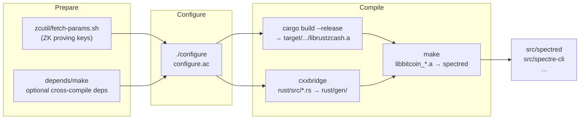
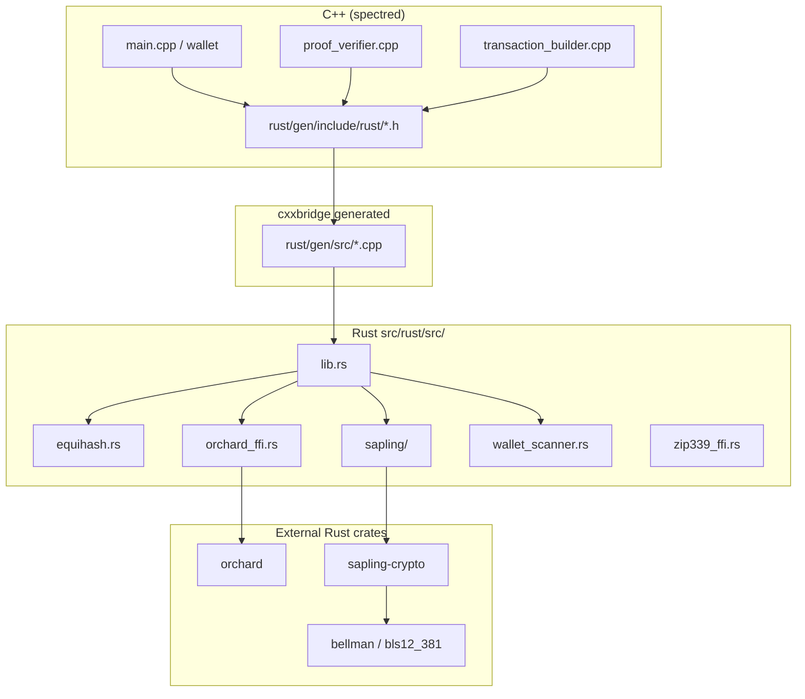
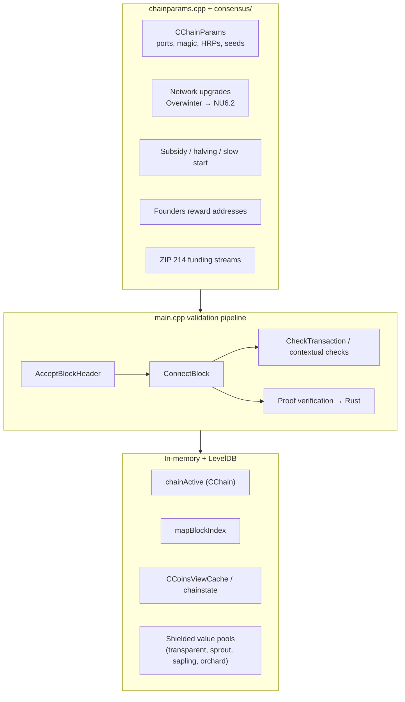
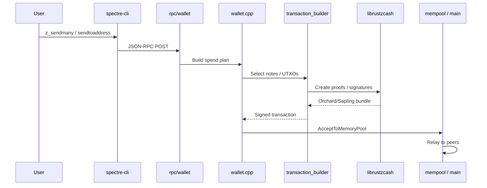
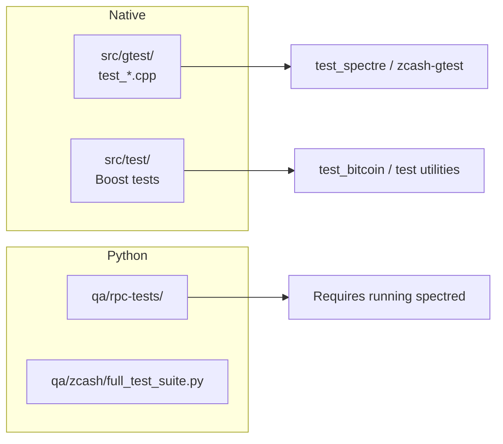
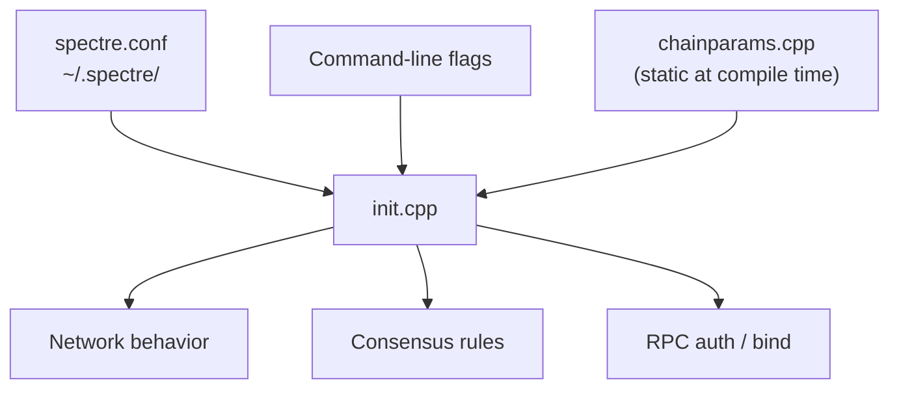

# Spectre codebase architecture

Spectre is a **full-node privacy cryptocurrency** forked from Zcash 6.x (itself descended from Bitcoin Core). The reference implementation ships as native **C++** for networking, validation, and RPC, plus **Rust** for zero-knowledge cryptography, Equihash, and wallet tooling.

This document describes how the repo is organized, how processes talk to each other at runtime, and where Spectre-specific configuration lives.

---

## At a glance

| Layer | Role | Main languages |
|-------|------|----------------|
| **Binaries** | CLI tools users run | C++ (+ Rust wallet tool) |
| **Node server** | P2P, mempool, block validation, mining | C++ |
| **Wallet** | Keys, balances, shielded tx building | C++ orchestration + Rust crypto |
| **Consensus** | Rules, upgrades, subsidies, funding streams | C++ |
| **ZK / crypto** | Sprout, Sapling, Orchard proofs, Equihash | Rust (`librustzcash`) via FFI |
| **Storage** | Chain index, UTXO/set, wallet DB | LevelDB (+ optional BDB wallet) |
| **Build** | Autotools + `depends/` cross-deps + Cargo | shell, make, Rust |

**Shipped programs (Spectre names):**

| Binary | Source entry | Purpose |
|--------|--------------|---------|
| `spectred` | `src/bitcoind.cpp` → `AppInit()` | Full node + optional wallet + JSON-RPC |
| `spectre-cli` | `src/bitcoin-cli.cpp` | RPC client |
| `spectre-tx` | `src/bitcoin-tx.cpp` | Offline transaction utility |
| `spectred-wallet-tool` | `src/rust/bin/wallet_tool.rs` | Wallet maintenance (Rust) |

Legacy filenames (`bitcoind.cpp`, `bitcoin-cli.cpp`) remain from upstream; Autotools maps them to Spectre binary names in `src/Makefile.am` and `configure.ac`.

---

## Repository map

Realistic top-level layout — what each area is for:

```
spectre-crypto/
├── configure.ac / Makefile.am    # Autotools root; defines spectred, ports, features
├── Cargo.toml                    # Rust crate: librustzcash + spectred-wallet-tool
├── depends/                      # Reproducible dependency builds (Boost, OpenSSL, Rust, …)
├── zcutil/                       # fetch-params.sh, build.sh, release helpers
├── src/                          # Almost all node + wallet C++ code
│   ├── bitcoind.cpp              # spectred main()
│   ├── init.cpp                  # Startup: params, DB, RPC, threads
│   ├── main.cpp                  # Validation, chain state, ConnectBlock (very large)
│   ├── chainparams.cpp           # ★ Spectre network identity, genesis, addresses
│   ├── consensus/                # Consensus params, upgrades, funding streams
│   ├── net.cpp, miner.cpp        # P2P and block template / mining
│   ├── rpc/                      # JSON-RPC command handlers
│   ├── wallet/                   # Wallet logic + async RPC operations
│   ├── zcash/                    # C++ Zcash types (addresses, notes, Merkle trees)
│   ├── script/                   # Script interpreter (Bitcoin-style + extensions)
│   ├── primitives/               # Block, transaction, amount types
│   ├── leveldb/                  # Embedded LevelDB (chain / index storage)
│   ├── secp256k1/                # Elliptic curve lib (transparent crypto)
│   ├── rust/                     # cxxbridge FFI + generated C++ stubs
│   ├── gtest/                    # Google Test suite (C++)
│   └── test/                     # Boost unit tests
├── qa/                           # Python RPC tests, full_test_suite, supply-chain vet
├── contrib/                      # Docker, devtools, example spectre.conf
└── doc/                          # CHAIN.md, LAUNCH.md, this file, man pages
```

★ = primary place to change Spectre mainnet/testnet behavior without touching crypto internals.

---

## Runtime architecture

When you run `spectred`, one OS process hosts several cooperating subsystems:

```mermaid
flowchart TB
    subgraph Process["spectred process"]
        INIT["init.cpp\nAppInit2()"]
        NET["net.cpp\nP2P peer manager"]
        VAL["main.cpp\nvalidation + chainActive"]
        MEM["txmempool.cpp\nmempool"]
        MIN["miner.cpp\nblock templates"]
        RPC["httpserver + httprpc\nrpc/*.cpp"]
        WAL["wallet/*.cpp\n(optional ENABLE_WALLET)"]
        SCH["scheduler\nbackground jobs"]
        MET["metrics.cpp\nstatus / UI hooks"]
        INIT --> NET
        INIT --> VAL
        INIT --> RPC
        INIT --> WAL
        INIT --> SCH
        NET --> VAL
        VAL --> MEM
        MIN --> VAL
        RPC --> VAL
        RPC --> WAL
        WAL --> VAL
    end

    CLI["spectre-cli"] -->|HTTP JSON-RPC| RPC
    PEERS["Other spectred nodes"] <-->|P2P :8733 / :18733| NET
    DISK["~/.spectre/\nblocks/, chainstate/, wallet.dat"] --> VAL
    DISK --> WAL
    PARAMS["~/.spectre-params/\nsapling/, orchard/"] --> RUST
    subgraph RUST["librustzcash (static)"]
        RUST["Proof verify,\nEquihash,\nOrchard/Sapling,\nZIP32"]
    end
    VAL --> RUST
    WAL --> RUST
```

**Startup sequence (simplified):**

1. `bitcoind.cpp`: parse args, read `spectre.conf`, `SelectParams(main|test|regtest)`.
2. `AppInit2()` in `init.cpp`: lock data dir, load chainparams, open LevelDB (`txdb.cpp`), load checkpoints.
3. Load block index from disk; optionally reindex.
4. Start HTTP server and JSON-RPC (`httprpc.cpp`); register commands from `rpc/register.h`.
5. `StartNode()`: outbound connections, address manager, block sync loop.
6. Wallet (if enabled): load `wallet.dat`, scan chain / note witnesses via Rust scanner.

---

## Build architecture

The build is **not** a single CMake project — it is Autotools wrapping C++ libraries, plus a Cargo build for Rust:



**Static libraries linked into `spectred`** (from `src/Makefile.am`):

| Library | Contents |
|---------|----------|
| `libbitcoin_server.a` | P2P, validation, RPC server, init, miner |
| `libbitcoin_wallet.a` | Wallet + async shielded operations |
| `libbitcoin_common.a` | Chainparams, keys, encoding, tx builder |
| `libbitcoin_consensus.a` | Consensus helpers exposed to scripts |
| `libbitcoin_util.a` | Logging, filesystem, args, time |
| `libcxxbridge.a` | Generated C++/Rust glue + `zcash/cache` |
| `libzcash.a` | C++ Zcash protocol types |
| `librustzcash` | Rust staticlib (Cargo) |

Optional: `libbitcoin_zmq.a` (ZMQ block/tx notifications), `libsecp256k1`, `univalue`.

---

## Language boundary: C++ ↔ Rust

Most **privacy cryptography** lives in Rust. C++ calls it through **cxxbridge** (typed FFI, not raw C ABI everywhere):



**Rule of thumb:** if it involves Groth16, Halo2, note commitment trees, or Equihash solution checking, assume Rust. If it involves block headers, peer messages, or script flags, assume C++.

Proving **parameters** (large files) are **not** in git — `zcutil/fetch-params.sh` downloads them to `~/.spectre-params/`.

---

## Consensus and chain state



**Spectre-specific consensus configuration** (identity only; economics mirror Zcash):

- `src/chainparams.cpp` — magic bytes, default ports, address HRPs (`spec`, `tspec`), BIP44 types, genesis, founders/funding addresses, upgrade activation **heights**.
- `src/chainparamsbase.cpp` — RPC ports, data directory names (`~/.spectre`, `spectre-testnet`).
- `src/consensus/params.cpp` — parses funding stream addresses at node construction; validates period counts.

**Important:** upgrade `hashActivationBlock` values and shared Zcash genesis are still upstream-shaped. A newly mined Spectre chain must either clear those hashes or set them after mining activation blocks on Spectre. See `doc/CHAIN.md` and `doc/LAUNCH.md`.

---

## Transaction and wallet path



Wallet supports **transparent** (Bitcoin-style), **Sprout** (legacy), **Sapling**, **Orchard**, and **Unified Addresses** (ZIP 316). High-level RPC lives in `src/wallet/rpcwallet.cpp`; long-running shielded ops use `asyncrpcoperation_*.cpp` and a worker queue.

---

## Storage layout

On disk (`~/.spectre/` on Linux, `%APPDATA%\Spectre` on Windows):

| Path | Backend | Holds |
|------|---------|--------|
| `blocks/` | Flat files | Raw block data (`blk*.dat`) |
| `chainstate/` | LevelDB | UTXO set, block index, chainwork |
| `database/` | BDB (wallet) | `wallet.dat` when wallet enabled |
| `debug.log` | text | Log output |
| `spectre.conf` | text | Node configuration |

LevelDB implementation is vendored under `src/leveldb/`. `src/txdb.cpp` and `src/dbwrapper.cpp` abstract access.

---

## Networking

| Network | P2P port | RPC port | Magic | Currency |
|---------|----------|----------|-------|----------|
| Mainnet | 8733 | 8732 | `SPEC` | SPEC |
| Testnet | 18733 | 18732 | `TSPC` | TSPEC |
| Regtest | 18344 | 18232 | (regtest) | RSPEC |

- **P2P:** `src/net.cpp`, `src/protocol.cpp` — headers-first sync, inv/getdata, peer scoring.
- **Peer discovery:** DNS seeds in `chainparams.cpp` (`vSeeds` — empty until you add seeds).
- **Addrman:** `src/addrman.cpp` — learned peer addresses.

Spectre nodes **cannot** sync to Zcash: different message start bytes and ports.

---

## RPC surface

JSON-RPC over HTTP (default `127.0.0.1:8732`). Commands registered in:

| Area | Files |
|------|--------|
| Blockchain / chain | `rpc/blockchain.cpp` |
| Mining | `rpc/mining.cpp` |
| Network | `rpc/net.cpp` |
| Raw transactions | `rpc/rawtransaction.cpp` |
| Wallet | `wallet/rpcwallet.cpp`, `wallet/rpcdump.cpp`, … |
| Server meta | `rpc/server.cpp`, `rpc/misc.cpp` |

`spectre-cli` (`src/bitcoin-cli.cpp` + `rpc/client.cpp`) serializes requests; it does not validate chain rules itself.

---

## Testing and QA



Functional tests assume a built node and mostly exercise RPC + chain behavior. They still contain legacy Zcash port defaults in places — update when running QA against Spectre ports.

---

## What Spectre renamed vs what stayed upstream

| Spectre-facing | Internal / upstream name (unchanged) |
|----------------|--------------------------------------|
| `spectred` | `bitcoind.cpp`, many `bitcoin-*` paths |
| `spectre.conf` | `BITCOIN_CONF_FILENAME` constant |
| `spec` / `s1` / `s3` HRPs & prefixes | `src/zcash/`, `libzcash`, `libzcash_script` |
| GitHub / docs | Zcash copyright headers in source files |
| No zcashd EOL shutdown | `deprecation.cpp` (Spectre no-op) |

Intentional: preserve merge compatibility with upstream Zcash crypto and reduce fork diff size. User-visible branding is in binaries, config paths, and `chainparams`.

---

## Configuration dependency graph



Most **network identity** is compile-time in `chainparams.cpp`. Operational tuning (peers, mining, RPC password) is runtime via config.

---

## Known startup gate (upstream leftover)

`spectred` still requires this line in `spectre.conf` (checked in `bitcoind.cpp` before params load):

```ini
i-am-aware-zcashd-will-be-replaced-by-zebrad-and-zallet-in-2025=1
```

That is a Zcash upstream deprecation acknowledgment, not a Spectre design choice. Removing it is a small fork cleanup task.

---

## Related docs

| Doc | Topic |
|-----|--------|
| [CHAIN.md](CHAIN.md) | Ports, HRPs, genesis, checkpoints |
| [LAUNCH.md](LAUNCH.md) | Pre-mainnet checklist |
| [developer-notes.md](developer-notes.md) | Coding conventions |
| [unit-tests.md](unit-tests.md) | Running tests |
| [INSTALL](../INSTALL) | Build instructions |

---

## Mental model (one paragraph)

**Spectre is a Bitcoin-derived full node where block validation and P2P are C++, and all serious zero-knowledge work is Rust behind cxxbridge.** Chain rules and Spectre network identity live in `chainparams.cpp` and `consensus/`; persistent state lives in LevelDB; the optional wallet orchestrates Rust proof builders to spend shielded notes. Building the tree means Autotools + Cargo + downloaded ZK params — not a single `cargo run`.
