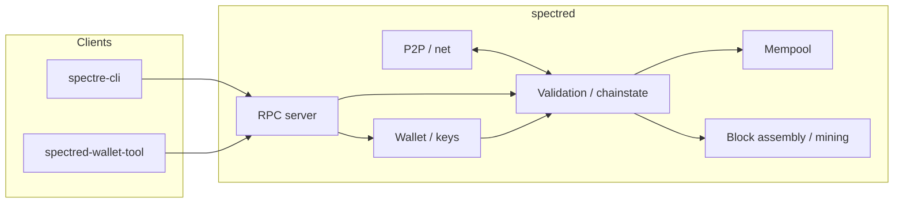

# Spectre architecture overview

Spectre is a full-node implementation forked from [Zcash 6.20](https://github.com/zcash/zcash), which itself extends Bitcoin Core. User-facing branding uses **Spectre** (`spectred`, `spectre-cli`, `spectre.conf`); many internal modules still use upstream names (`libzcash`, `src/zcash/`, `librustzcash`) — that is intentional to reduce merge risk and avoid breaking builds.

## High-level runtime



1. **P2P** downloads and relays blocks and transactions.
2. **Validation** applies consensus rules (Equihash PoW, NU activations, shielded semantics).
3. **Wallet** (optional) holds keys and builds transactions; shielded logic uses Rust (`librustzcash`) and Orchard/Sapling crates.
4. **RPC** exposes control and query APIs (`spectre-cli`, `spectred-wallet-tool`, integrations).

Data lives under `~/.spectre/` (blocks, chainstate, wallet, logs). Proving parameters use `~/.spectre-params/` (Sprout legacy params if needed; Sapling/Orchard bundled).

## Directory map (selected)

| Path | Role |
|------|------|
| `src/` | C++ node: consensus, net, RPC, wallet glue |
| `src/zcash/` | Zcash-specific C++ (addresses, notes, history) |
| `src/rust/` | Rust integration: ZIPs, wallet, Orchard |
| `src/secp256k1/`, `src/univalue/`, `src/leveldb/` | Vendored dependencies |
| `src/chainparams.cpp` | Network magic, ports, HRPs, activations |
| `depends/` | Reproducible cross-compilation dependency cache |
| `zcutil/` | Build/fetch scripts (upstream name retained) |
| `qa/rpc-tests/` | Functional RPC tests |
| `qa/zcash/` | Full test suite helpers, sec-hard checks |
| `contrib/` | Examples, docker (legacy upstream), devtools |

## Build pipeline

```text
./zcutil/fetch-params.sh   → params notice / Sprout path
./zcutil/build.sh          → depends + autotools + make
  → src/spectred, src/spectre-cli, src/spectre-tx
  → src/spectred-wallet-tool (Rust)
  → src/zcash-gtest, src/test/test_bitcoin (tests)
```

Autotools entry: `configure.ac` / `Makefile.am`. Package name is `spectre`; pkg-config may still export `libzcash_script`.

## Consensus and privacy

- **Transparent**: Bitcoin-style UTXO model.
- **Shielded**: Sprout (legacy), Sapling, Orchard — Groth16/ Halo2 proving; note commitment trees in block headers.
- **Network upgrades**: Height-based activations in `consensus/params.h` / `chainparams.cpp` (Overwinter through NU6.x).
- **Spectre-specific**: Custom P2P/RPC ports and HRPs; Zcash EOL auto-shutdown disabled in `deprecation.h`.

## Testing

| Layer | Target |
|-------|--------|
| Unit (Boost) | `src/test/test_bitcoin` |
| Unit (GoogleTest) | `src/zcash-gtest` |
| Functional | `qa/rpc-tests/` via `qa/pull-tester/rpc-tests.py` |
| QA scripts | `qa/zcash/full_test_suite.py` |

RPC tests spawn `spectred` with per-node `spectre.conf` under a temp datadir.

## What we deliberately did not rename

- **`libzcash` / `src/zcash/`** — large surface; consensus-adjacent.
- **RPC method names** (`z_sendmany`, etc.) — wallet/exchange compatibility within the Zcash API family.
- **`qa/zcash/`** — path used by CI and scripts; rename is cosmetic only.

Future renames should be scoped (e.g. docs + CI first, libraries last).

## Further reading

- [CHAIN.md](CHAIN.md) — ports, magic, HRPs
- [LAUNCH.md](LAUNCH.md) — mainnet checklist
- [developer-notes.md](developer-notes.md) — coding conventions (still partly Zcash-worded)
- [SECURITY.md](../SECURITY.md) — reporting and ops safety
